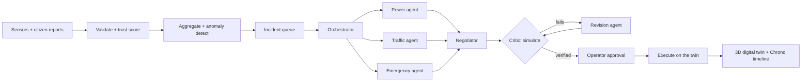

<div align="center">

# 🏙️ ChronoTwin

### A living 3D digital twin of a city, run by cooperating AI agents

**Detect** a cascading failure → **Negotiate** a joint plan → **Verify** it in simulation → **Approve** → **Act**

<br/>


**Team Spookies**

[Quick start](#-quick-start) · [Demo](#-the-demo-story) · [Architecture](#-how-it-works) · [Real cities](#-real-cities-from-openstreetmap) · [Operator dashboard](#-operator-dashboard--audit-history) · [Troubleshooting](#-troubleshooting)

</div>

---

## ✨ Why ChronoTwin

City infrastructure fails in **cascades**: a flooded underpass blocks ambulances, a substation trip kills traffic signals, and the resulting gridlock delays the crews who could fix both. Each department sees only its own console. ChronoTwin gives them one shared picture, a team of agents that plans across departments, and a simulator that **proves a plan works before anything is touched**.

| | |
|---|---|
| 🔎 **Cascade detection** | Traces how a failure propagates: power → signals → roads → hospitals |
| 🤝 **Multi-agent negotiation** | Power, Traffic and Emergency agents propose; a Negotiator resolves conflicts |
| 🧪 **Verify before act** | A Critic replays every joint plan in the simulator; failed plans are revised |
| 🧑‍⚖️ **Human in the loop** | `HIGH`-impact actions wait for operator approval, with full audit trail |
| ⏳ **Chrono timeline** | Compare *before*, *now* and *what-if* futures side by side in 3D |
| 📴 **Fully offline** | Default config needs no Docker and no API keys |

---

## 🧭 Design principles

1. **LLM calls scale with incidents, not data.** Raw sensor data is reduced by code before any agent sees it.
2. **Proposals are data, not actions.** Agents only call read/estimate tools while planning; mutating actions are returned as `Action` objects and executed only after verification and approval.
3. **Verify before act.** Nothing reaches the twin unless the Critic's simulation passes.
4. **Humans approve high-impact actions.** `HIGH` impact waits for the operator.
5. **Untrusted input is never a command.** Only structured fields reach agents; free text is stored, never prompted.
6. **Runs offline.** `LLM_MODE=scripted` or `ollama` needs no live API.

---

## ⚙️ How it works



<details>
<summary><b>Repository layout</b></summary>

```text
chronotwin/
├── docker-compose.yml          Timescale + Redis + Redpanda (optional)
├── .env.example                every setting, with offline defaults
├── backend/
│   ├── pyproject.toml
│   ├── data/                   audit.sqlite3 (git-ignored, created at runtime)
│   └── app/
│       ├── main.py             FastAPI app, WebSocket, startup wiring
│       ├── runtime.py          active-city runtime (demo or imported)
│       ├── config.py           settings (env / .env)
│       ├── models.py           Pydantic domain models
│       ├── db/                 schema.sql, asyncpg pool, SQLite audit store
│       ├── city/               demo city, OSM importer, cascade tracer
│       ├── sim/                state, engine, scenarios
│       ├── ingest/             bus, validator, trust, aggregator, anomaly, API
│       ├── agents/             orchestrator, specialists, negotiator, critic, workflow, llm
│       ├── tools/              power, traffic, emergency, plan (read vs mutate split)
│       ├── services/           community complaint verification
│       ├── api/                audit, cities, commands, community, incidents,
│       │                       infrastructure, plans, scenarios, simulations, timeline, ws
│       └── tests/              pytest
├── frontend/                   Vite + React 18 + TypeScript + Three.js
│   └── src/
│       ├── App.tsx, api.ts, useChronoSocket.ts, types.ts
│       └── components/         TwinScene (3D), ControlPanel, SimulationPanel, TimelineBar,
│                               IncidentPanel, ChatterPanel, ComplaintsPanel,
│                               PlanPanel, OperatorDashboard
└── README.md
```

</details>

---

## 🚀 Quick start

The app runs as two local processes. The default configuration (`BUS=memory`, `LLM_MODE=scripted`) runs the **full demo with no Docker and no API keys**.

### Prerequisites

| Tool | Version | Needed for |
|---|---|---|
| Python | 3.11+ | backend (always) |
| Node.js | 18+ (npm 9+) | frontend (always) |
| Docker | any recent | **optional**: only for `BUS=redpanda`, TimescaleDB, Redis |

### 1️⃣ Backend (terminal 1)

<details open>
<summary><b>Windows (PowerShell)</b></summary>

```powershell
cd backend
python -m venv .venv
.venv\Scripts\Activate.ps1
pip install -e ".[dev]"            # add ",agents" for google-adk / litellm extras
Copy-Item ..\.env.example ..\.env  # optional; defaults already work offline
python -m uvicorn app.main:app --reload --port 8000
```

</details>

<details>
<summary><b>macOS / Linux</b></summary>

```bash
cd backend
python3.11 -m venv .venv           # or just: python -m venv .venv
source .venv/bin/activate
pip install -e ".[dev]"            # add ",agents" for google-adk / litellm extras
cp ../.env.example ../.env         # optional; defaults already work offline
python -m uvicorn app.main:app --reload --port 8000
```

</details>

Check it is up:

```bash
curl http://localhost:8000/api/health     # {"ok":true,...}
```

API and interactive docs: **http://localhost:8000** · **http://localhost:8000/docs**

> [!NOTE]
> `config.py` loads `.env` from `backend/`, then the repository root (`../.env`), and finally falls back to the checked-in `.env.example`, so the demo works even before you create a `.env`.

### 2️⃣ Frontend (terminal 2)

```bash
cd frontend
npm install
npm run dev          # http://localhost:5173
```

Vite proxies `/api` and `/ws` to `http://localhost:8000`, so keep the backend running on port 8000. A production type-check and bundle is `npm run build` (runs `tsc -b` first; Vite's "chunk larger than 500 kB" notice is expected because Three.js is bundled).

### 3️⃣ Trigger the demo

**In the UI (recommended):** open **http://localhost:5173** and press **Combined** in the bottom bar. You will watch the whole pipeline stream over the WebSocket:

> detect → plan → negotiate → critic (fails → revises) → verified → **human approve** → execute

with the 3D twin updating live and a *time to verified plan* metric.

**From a terminal:**

```bash
curl -X POST http://localhost:8000/api/scenarios/combined/start   # flood + substation trip
curl -X POST http://localhost:8000/api/scenarios/flood/start
curl -X POST http://localhost:8000/api/scenarios/trip/start
curl -X POST http://localhost:8000/api/scenarios/reset
```

**Try the what-if branch:** press **What-if ↯** in the UI bar. It replays "clear the flood + restore S2" *in the simulator only* (never the live twin) and switches the 3D view to the ghost branch.

### 🧪 Run the backend tests

```bash
cd backend
pytest        # city graph, simulator, ingest, agents/workflow, community, audit
```

### 🐳 Optional: full infrastructure stack

Only needed for `BUS=redpanda` or persisting to TimescaleDB.

<details>
<summary><b>Windows</b></summary>

```powershell
docker compose up -d
Get-Content backend\app\db\schema.sql | docker compose exec -T timescale psql -U twin -d chronotwin
# then set BUS=redpanda in ..\.env and restart uvicorn
```

</details>

<details>
<summary><b>macOS / Linux</b></summary>

```bash
docker compose up -d
docker compose exec -T timescale psql -U twin -d chronotwin < backend/app/db/schema.sql
# then set BUS=redpanda in ../.env and restart uvicorn
```

</details>

---

## 🏘️ The built-in demo city

The default city is a small hand-built grid so scenarios stay reproducible.

| Part | Contents |
|---|---|
| **Core (zones Z1–Z2)** | Junctions J1–J8 and N5–N7, flood-prone underpass **U1** on `E_J4_J6_U1`, hospital **H1** (City General), ambulance depot, **Riverside Shelter**, substations **S1** and **S2** |
| **Eastern extension (zone Z3)** | East junctions E1–E6, four checkpoint junctions **CP1–CP4** (tagged `checkpoint`), and substation **S3** with feeders F5/F6 powering the eastern signals |
| **Buildings** | 13 synthetic footprints (tagged `synthetic`) that go through the same 3D extrusion path as imported OSM buildings |
| **Utilities** | Three synthetic water mains (`PIPE_Z1`–`PIPE_Z3`), each tied to an explicit affected road |

The original core is unchanged, so existing scenarios and routes behave as before. Any imported OSM city replaces the demo city until the backend restarts.

---

## 🎬 The demo story

A flood hits underpass **U1**, substation **S2** trips, junctions **J2–J5** go dark, the detour is dark too, and ambulance **A1**, bound for hospital **H1**, is delayed.

1. ChronoTwin **traces the cascade**.
2. The **Power**, **Traffic** and **Emergency** agents propose actions.
3. A seeded conflict is resolved by the **Negotiator**.
4. The **Critic rejects** the first plan and the **Revision agent** fixes it.
5. The **operator approves**.
6. The **Chrono timeline** shows before / after / what-if.

The eastern grid on **S3** is unaffected by the S2 trip, which makes it a handy comparison when you try your own hazards.

---

## 🗺️ Real cities from OpenStreetMap

The built-in Flood / Trip / Combined buttons are deterministic demo scenarios, useful for smoke tests but **not** the only simulation path. The API can import a real-world road and building area and run hazards against whichever city graph is active.

### Import an area

The importer accepts a WGS84 bounding box and queries an Overpass endpoint. It imports:

- 🛣️ drivable roads as route edges (length, lanes, speed, names, OSM tags)
- 🏢 building footprints with height/levels for local 3D extrusion
- 🏥 hospitals and ⚡ substations when mapped in the area
- 💧 waterways, power lines and pipelines as preserved infrastructure assets

> [!IMPORTANT]
> Use a small area (the API enforces a maximum bbox size) and keep the attribution the API returns: **© OpenStreetMap contributors · ODbL**. See <https://www.openstreetmap.org/copyright>.

```bash
# Example: a small Midtown Manhattan area
curl -X POST http://localhost:8000/api/cities/import/osm \
  -H "Content-Type: application/json" \
  -d '{"south":40.7485,"west":-73.9955,"north":40.7515,"east":-73.9915,"name":"Midtown sample"}'

# Inspect the active city and the event targets available to simulations
curl http://localhost:8000/api/cities/current
curl http://localhost:8000/api/simulations/capabilities
```

The imported city is held in memory and becomes the active city for the running backend process. Restarting returns to the demo city; production persistence can be added with the existing database layer.

### Run a custom simulation

Use an edge ID from `/api/simulations/capabilities` or `/api/city`. Hazard types: `flood` · `close_edge` · `power_outage` · `signal_dark`.

```bash
curl -X POST http://localhost:8000/api/simulations/run \
  -H "Content-Type: application/json" \
  -d '{
    "label":"custom flood test",
    "start_from":"healthy",
    "hazards":[ {"type":"flood","edge_id":"OSM_E_REPLACE_ME","depth_cm":120} ]
  }'
```

The response includes an `answer`, an `explanation` list, affected nodes, before/after snapshots, blocked edges and a trace, so the physical result is explained without depending on an LLM.

### Power, water, hospitals and emergency vehicles

```bash
curl "http://localhost:8000/api/infrastructure/diagnostics?domain=power"   # likely failing station
curl "http://localhost:8000/api/infrastructure/diagnostics?domain=water"   # pressure / failure state
curl http://localhost:8000/api/hospitals                                    # departments + beds
curl http://localhost:8000/api/hospitals/H1

# Smart route for firetruck, police or ambulance
curl -X POST http://localhost:8000/api/routes/vehicles \
  -H "Content-Type: application/json" \
  -d '{"vehicle_type":"firetruck","origin":"DEPOT","hospital_id":"H1"}'
```

The 3D map marks hospitals as separate selectable assets; selecting one shows department-level bed availability. Selecting a road, substation, power line or water asset offers a safe **Preview disable in What-if** action rather than silently mutating the live twin.

### 💬 Chat-style scenario commands

The **Scenario command** box accepts deterministic commands without an LLM:

```bash
curl -X POST http://localhost:8000/api/commands/run \
  -H "Content-Type: application/json" \
  -d '{"text":"rain 120 mm","start_from":"current"}'
```

Other examples: `set substation S2 load to 45 MW` · `trip substation S2` · `break wire ASSET_ID` · `break pipe ASSET_ID` · `disable selected feature`.

These produce a What-if result with a plain-language answer, explanations, affected entities and before/after state. They never bypass the approval workflow for live actions.

### 📐 What is and is not modeled

| Status | Details |
|---|---|
| ✅ **Implemented** | Topology-driven travel times, flooded/closed edge blocking, signal-dark congestion penalties, OSM road/building import, local 3D extrusion, power overload and station diagnostics, water pressure / pipe-break state, hospital department capacity, firetruck / police / ambulance routing |
| 🧩 **Preserved for extension** | OSM power lines, waterways and pipelines are returned as infrastructure assets and can be selected or failed in What-if runs |
| 🚫 **Not invented** | If a city does not map its feeders, pipes, sensors, elevations or building heights in OSM, the simulator does not pretend they exist |
| 🔭 **Next production layer** | Authoritative utility GIS / SCADA / IoT feeds and domain solvers for hydraulics, load flow, drainage, terrain and sensor calibration |

---

## 🖥️ Operator dashboard & audit history

The UI has two explicit surfaces:

| Surface | What it offers |
|---|---|
| **City Simulation** | 3D city, sensor controls, cumulative what-if hazards, automatic emergency-route overlays, station generation/load controls, pipeline pressure previews, and a region-based mass-complaint event control |
| **Operator Dashboard** | Complaint verification status, watch-only evidence, community interruptions, every complaint batch, agent handoffs, agent/tool audit trails, current plan status, and the normal approve / reject workflow |

Example simulation controls:

```text
disable nodes J4, J5
close roads E_J4_J6_U1, E_J5_J7
set station S2 generation to 18 MW
```

<details>
<summary><b>Routing and complaint-evidence rules</b></summary>

- Road routing is recalculated from the displayed snapshot. Closed, flooded, feeder-only and unreachable edges are excluded from the ambulance graph; an unreachable destination returns no stale path. Congestion stays traversable but costs more travel time.
- Pipeline pressure is a hypothesis sensor: below **150 kPa** is a probable leak, below **20 kPa** a probable burst. Only synthetic or imported pipelines with an explicit `affected_edge` tag can flood a road; proximity is never inferred.
- A mass complaint event is stored as untrusted display evidence. With no matching structured simulator evidence, fewer than **50** reports stay watch-only; **50 or more** structured complaints for one region and one topic create a bounded simulation inference (for example a mapped pipeline leak or a likely substation outage) even without a sensor reading. The inference never uses resident text, never executes an action, and still goes through the Critic and operator approval.

</details>

### 🗄️ Persistent history and human intervention

The Operator Dashboard reads **durable audit records from the backend database**, not the browser's recent WebSocket messages. The offline demo uses SQLite at `backend/data/audit.sqlite3` (override with `AUDIT_DB_PATH`). It is separate from the optional PostgreSQL/Timescale telemetry configuration, needs no Docker, and is git-ignored because complaint messages and operator notes are private runtime data.

- **Recorded:** city installation/reset/state, simulation hazards and before/after snapshots, pipeline pressure previews, route recalculations, complaint batches and verification, agent read/propose calls, negotiation, Critic revisions, plan versions, human decision notes, execution attempts and results.
- **Previews are labelled** *What-if, no live change*. The dashboard refreshes every three seconds and offers event-type / scope / plan filters, older-page navigation and a JSON export of all matching records. There is no automatic history truncation.
- **Review → decide → apply:** review all actions and targets, enter a decision note, then **Approve response** or **Reject**. Approval alone changes no city state; **Apply approved response** is a separate step, and **Withdraw approval** cancels it before execution.
- **All generated plans need human approval.** Removing an action creates a new version and reruns safety verification. Changed city state or changed actions invalidate approval; rejected, failed or already-executed responses cannot run.
- **Plan verified live incidents** uses server-owned evidence only. A verified mapped pipeline failure may propose `water.isolate_pipeline` (`HIGH` impact), stopping simulated supply on that segment without claiming the pipe is repaired or floodwater drained. Power actions use the same approval gate. No new fire/electrical dispatch integration is introduced.
- **Previews never become live authorization.** In Present view, complaint evidence is checked server-side against live state. Use **Combined**, then open the Operator Dashboard, to try the full live-simulation review flow.

**Audit API:** `GET /api/audit/events` (cursor pagination) · `GET /api/audit/plans` (saved plan history) · `GET /api/audit/pending` (current-runtime approval queue) · `POST /api/plans/generate`. The existing approve / edit / execute APIs are retained.

> [!WARNING]
> History survives city resets and backend restarts, but restart does **not** restore live city state or make old approvals executable: older runtimes are read-only history. Recording began with this update; earlier memory-only events cannot be reconstructed. The local database is not tamper-proof archival storage and the demo API has no authenticated operator roles. Do not expose it publicly or attach real utility actuators without authentication, authorization, backups and a production operational safety review.

---

## 🔌 API at a glance

Interactive docs live at **http://localhost:8000/docs**. The UI streams live updates from the `ws://localhost:8000/ws` WebSocket.

| Area | Endpoints |
|---|---|
| **Status** | `GET /` · `GET /api/health` · `GET /api/city` (active city graph) |
| **Scenarios** | `POST /api/scenarios/{combined\|flood\|trip}/start` · `POST /api/scenarios/reset` |
| **Incidents** | `GET /api/incidents` · `/cascade` · `/dependency-graph` · `/watch` · `/state` |
| **Plans** | `GET /api/plans` · `/current` · `/metrics` · `/action_log` · `POST /edit` · `/manual` · `/approve` · `/execute` · `/generate` |
| **Timeline / what-if** | `GET /api/timeline` · `/metrics` · `POST /api/timeline/whatif` |
| **Simulation** | `POST /api/simulations/run` · `/tick` · `/fork` · `GET /capabilities` |
| **Cities** | `GET /api/cities/current` · `POST /api/cities/import/osm` |
| **Infrastructure** | `GET /api/infrastructure/assets` · `/diagnostics` · `POST /diagnostics/preview` · `GET /api/hospitals[/{id}]` · `POST /api/routes/vehicles` |
| **Commands** | `POST /api/commands/run` |
| **Community** | `GET /api/community/state` · `POST /complaints` · `/pipeline-preview` · `/plan` |
| **Audit** | `GET /api/audit/events` · `/plans` · `/pending` |
| **Ingest** | `POST /api/ingest/sensor` · `/sensor/batch` · `/report` · `GET /health` |

<details>
<summary><b>Ingest guardrails</b></summary>

Sensor readings and citizen reports enter through the ingest API and then the validator, trust scorer, aggregator and anomaly detector before any agent sees them.

- Optional `X-API-Key` header (set `INGEST_API_KEY`) and a per-client rate limit (`INGEST_RATE_LIMIT_PER_MINUTE`, default 120).
- Citizen reports are de-duplicated by category, zone and rounded location within `DEDUPE_WINDOW_S` (default 30 s).
- Set `CAPTCHA_REQUIRED=true` to require an `X-Captcha-Token` header (demo token: `demo`).
- Report free text is stored for audit but **never published to the bus or prompted**; only structured fields continue.

</details>

---

## 🎛️ Modes

| Knob | Values | Effect |
|---|---|---|
| `BUS` | `memory` \| `redpanda` | in-process `asyncio.Queue` vs Kafka topics |
| `LLM_MODE` | `scripted` \| `ollama` \| `gemini` \| `claude` | deterministic replay vs local vs live model |
| `LLM_CALL_BUDGET` | int | per-run cap proving "LLM calls scale with incidents, not data" |

For live models set `LLM_MODE=gemini` + `GEMINI_API_KEY` (or `claude` + `ANTHROPIC_API_KEY`) and run `pip install -e ".[agents]"`. For a local model set `LLM_MODE=ollama` against `OLLAMA_BASE_URL`.

---

### All settings

Set these in `.env` (copied from `.env.example`); every one has an offline default.

| Group | Variables |
|---|---|
| **Infrastructure** | `DATABASE_URL` · `REDIS_URL` · `KAFKA_BOOTSTRAP` · `BUS` |
| **Audit** | `AUDIT_DB_PATH` (default `backend/data/audit.sqlite3`) |
| **LLM** | `LLM_MODE` · `LLM_MODEL` · `LLM_CALL_BUDGET` · `GEMINI_API_KEY` · `ANTHROPIC_API_KEY` · `OLLAMA_BASE_URL` · `LLM_FALLBACK_MODE` · `LLM_FALLBACK_MODEL` |
| **Simulator** | `SIM_TICK_SECONDS` (1.0) · `SIM_SEED` (1337) |
| **OSM import** | `OVERPASS_URL` · `OSM_USER_AGENT` |
| **Ingest** | `WINDOW_SECONDS` · `TRUST_ACTION_THRESHOLD` · `DEDUPE_WINDOW_S` · `INGEST_API_KEY` · `INGEST_RATE_LIMIT_PER_MINUTE` · `CAPTCHA_REQUIRED` |
| **API** | `API_HOST` · `API_PORT` · `LOG_LEVEL` |

---

## 🛡️ Safety

Mutating tools are **never registered directly with an agent**. Agents submit `Action` proposals via read/estimate tools only. The Critic verifies the joint plan in simulation, `HIGH`-impact actions require operator approval in the UI before `POST /api/plans/execute` writes to the twin, and every step lands in the `action_log` (`GET /api/plans/action_log`).

---

## 🩺 Troubleshooting

| Symptom | Fix |
|---|---|
| `ECONNREFUSED :8000` from the UI | The backend isn't running. Start uvicorn first |
| Frontend loads but no live updates | Check the **LIVE / OFFLINE** dot in the header; the `/ws` proxy needs uvicorn on port 8000 |
| Port already in use | Run uvicorn on another port and change the Vite proxy target in `frontend/vite.config.ts` |
| `pip install` picks an old Python | Use `python -m venv` with an explicit 3.11+ interpreter; check `python --version` |
| Redpanda connection errors | Stay on the default `BUS=memory`, or run `docker compose up -d` |

---

<div align="center">

**Built by Team Spookies for ChronoForge 2026 · NITK Surathkal**

Map data © OpenStreetMap contributors · ODbL

---

</div>